<p>
<picture>
  <source media="(prefers-color-scheme: light)" srcset="assets/banner/hero-v3-light.svg">
  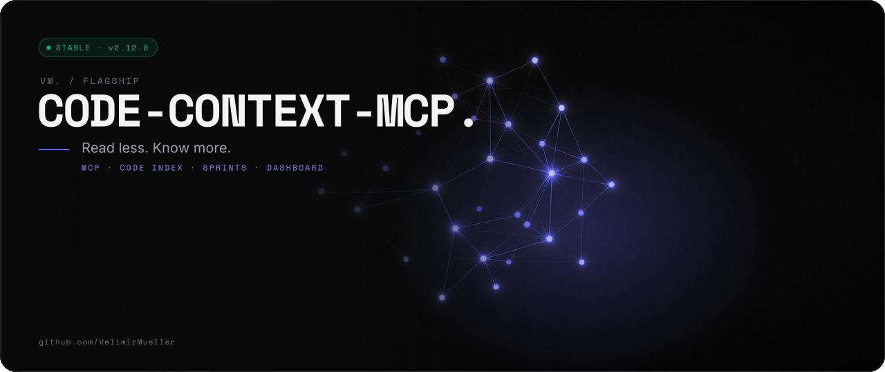
</picture>
</p>

<p>
<picture>
  <source media="(prefers-color-scheme: light)" srcset="assets/readme/lead-v3-light.svg">
  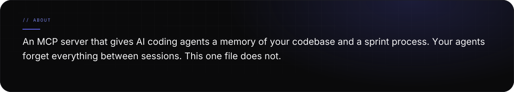
</picture>
</p>

<p>
<picture>
  <source media="(prefers-color-scheme: light)" srcset="assets/readme/stats-v3-light.svg">
  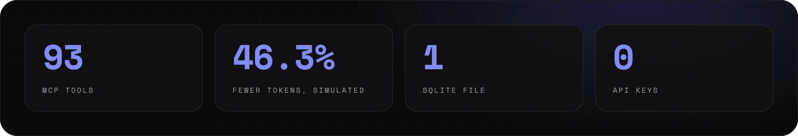
</picture>
</p>

<p align="center">
<a href="https://www.npmjs.com/package/vlm-code-context-mcp"><picture><source media="(prefers-color-scheme: light)" srcset="assets/readme/links-1-v3-light.svg">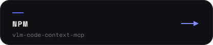</picture></a>
<a href="LICENSE"><picture><source media="(prefers-color-scheme: light)" srcset="assets/readme/links-2-v3-light.svg"></picture></a>
<a href="https://velimirmueller.github.io/code-context-mcp/"><picture><source media="(prefers-color-scheme: light)" srcset="assets/readme/links-3-v3-light.svg"></picture></a>
</p>

<br>

<p>

</p>

<p>
<picture>
  <source media="(prefers-color-scheme: light)" srcset="assets/readme/features-v3-light.svg">
  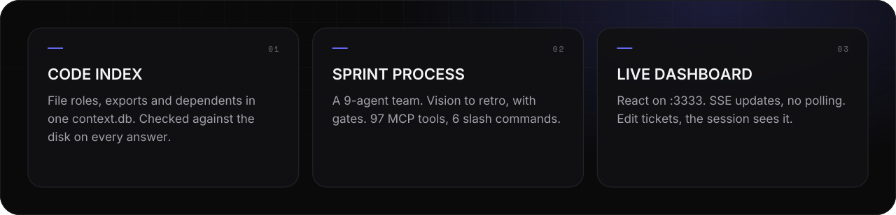
</picture>
</p>

<p>
<picture>
  <source media="(prefers-color-scheme: light)" srcset="assets/readme/what-v3-light.svg">
  
</picture>
</p>

<br>

<p>

</p>

<p>
<picture>
  <source media="(prefers-color-scheme: light)" srcset="assets/readme/start-v3-light.svg">
  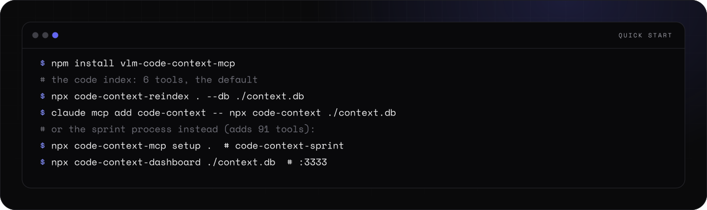
</picture>
</p>

<details>
<summary><picture><source media="(prefers-color-scheme: light)" srcset="assets/readme/links-13-v3-light.svg"></picture></summary>

```bash
# Requires Node.js 22 or newer. Node.js 24 LTS is recommended.
npm install vlm-code-context-mcp

# The code index (default): 6 tools
npx code-context-reindex . --db ./context.db
claude mcp add code-context -- npx code-context ./context.db

# Or the sprint process instead: setup installs code-context-sprint, /kickoff, the dashboard
npx code-context-mcp setup .
npx code-context-dashboard ./context.db   # optional: live dashboard on :3333
```

```bash
# override the watch directory (4th argument)
npx code-context-dashboard ./context.db 3333 .
```

```text
/kickoff
```

</details>

<p>
<picture>
  <source media="(prefers-color-scheme: light)" srcset="assets/readme/setup-v3-light.svg">
  
</picture>
</p>

<br>

<p>

</p>

<p>
<picture>
  <source media="(prefers-color-scheme: light)" srcset="assets/readme/flow-v3-light.svg">
  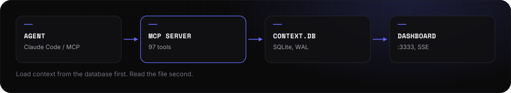
</picture>
</p>

<p>
<picture>
  <source media="(prefers-color-scheme: light)" srcset="assets/readme/pattern-v3-light.svg">
  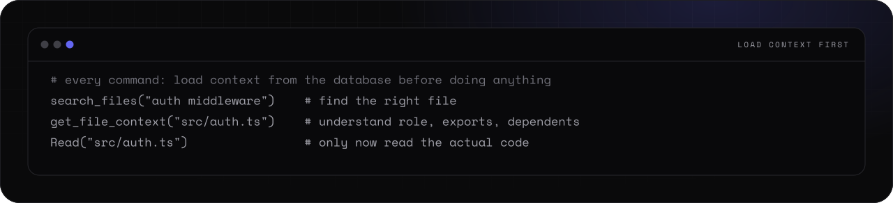
</picture>
</p>

<details>
<summary><picture><source media="(prefers-color-scheme: light)" srcset="assets/readme/links-13-v3-light.svg"></picture></summary>

```text
search_files("auth middleware")       → find the right file
get_file_context("src/auth.ts")      → understand role, exports, dependents
Read("src/auth.ts")                  → only now read the actual code
```

</details>

<p>
<picture>
  <source media="(prefers-color-scheme: light)" srcset="assets/readme/arch-v3-light.svg">
  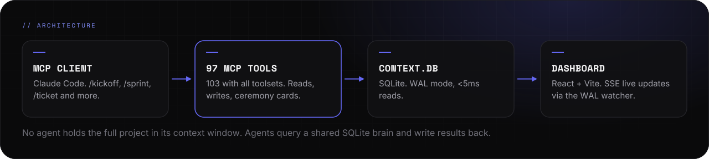
</picture>
</p>

<p>
<picture>
  <source media="(prefers-color-scheme: light)" srcset="assets/readme/how-v3-light.svg">
  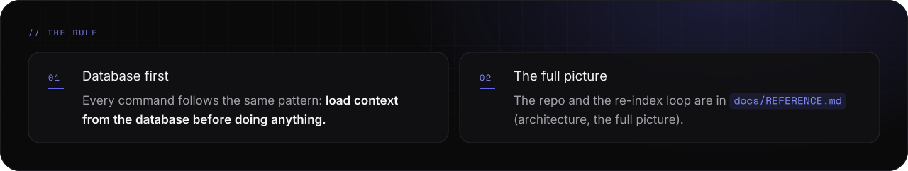
</picture>
</p>

<p align="center">
<a href="docs/REFERENCE.md"><picture><source media="(prefers-color-scheme: light)" srcset="assets/readme/links-4-v3-light.svg">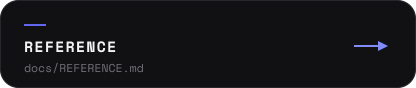</picture></a>
<a href="docs/REFERENCE.md#architecture-the-full-picture"><picture><source media="(prefers-color-scheme: light)" srcset="assets/readme/links-5-v3-light.svg">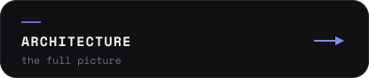</picture></a>
</p>

<br>

<p>

</p>

<p>
<picture>
  <source media="(prefers-color-scheme: light)" srcset="assets/readme/bench-about-v3-light.svg">
  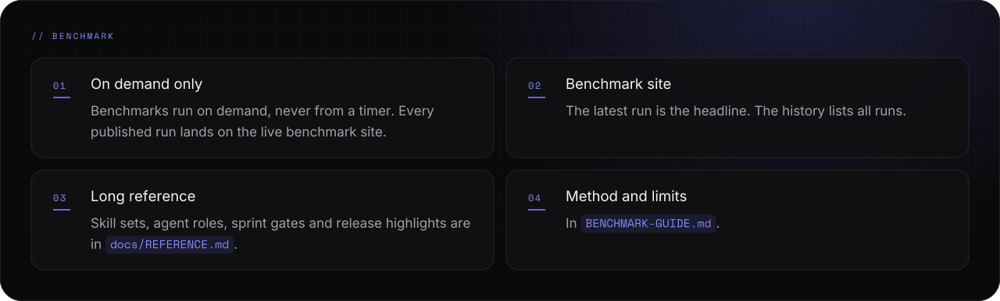
</picture>
</p>

<p align="center">
<a href="https://velimirmueller.github.io/code-context-mcp/"><picture><source media="(prefers-color-scheme: light)" srcset="assets/readme/links-3-v3-light.svg"></picture></a>
<a href="BENCHMARK-GUIDE.md"><picture><source media="(prefers-color-scheme: light)" srcset="assets/readme/links-6-v3-light.svg"></picture></a>
</p>

<p>
<picture>
  <source media="(prefers-color-scheme: light)" srcset="assets/readme/bench-kinds-v3-light.svg">
  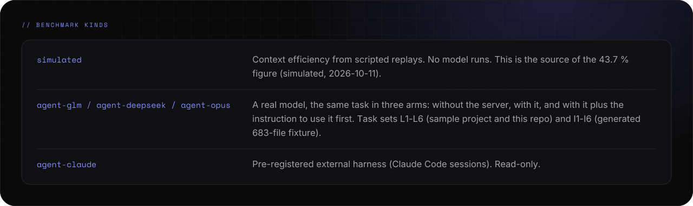
</picture>
</p>

<p>
<picture>
  <source media="(prefers-color-scheme: light)" srcset="assets/readme/bench-runs-v3-light.svg">
  
</picture>
</p>

<p>
<picture>
  <source media="(prefers-color-scheme: light)" srcset="assets/readme/bench-read-v3-light.svg">
  
</picture>
</p>

<p>
<picture>
  <source media="(prefers-color-scheme: light)" srcset="assets/readme/bench-run-v3-light.svg">
  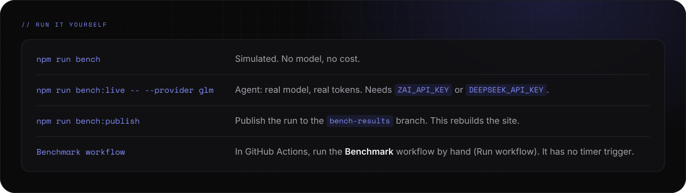
</picture>
</p>

<details>
<summary><picture><source media="(prefers-color-scheme: light)" srcset="assets/readme/links-13-v3-light.svg"></picture></summary>

```bash
# Simulated (no model, no cost)
pnpm run bench

# Agent (real model, real tokens; needs ZAI_API_KEY or DEEPSEEK_API_KEY)
pnpm run bench:live --provider glm

# Publish the run to the bench-results branch (rebuilds the site)
pnpm run bench:publish
```

</details>

<p>
<picture>
  <source media="(prefers-color-scheme: light)" srcset="assets/readme/pages-v3-light.svg">
  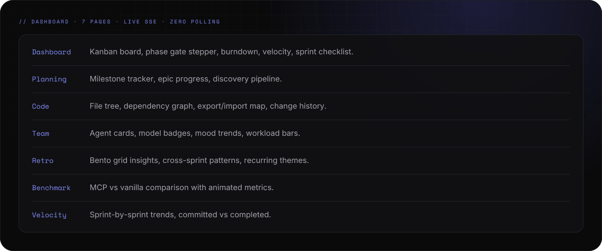
</picture>
</p>

<p>
<picture>
  <source media="(prefers-color-scheme: light)" srcset="assets/readme/board-v3-light.svg">
  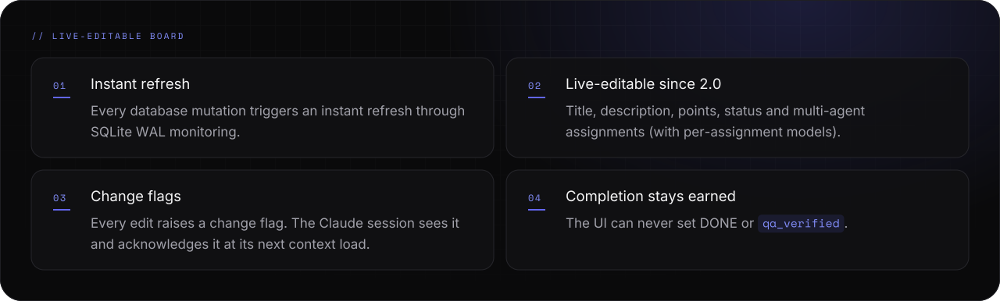
</picture>
</p>

<p align="center">
<a href="https://github.com/user-attachments/assets/52e2fbca-1e65-4ec9-a0fe-f11f000b1510"><picture><source media="(prefers-color-scheme: light)" srcset="assets/readme/links-7-v3-light.svg">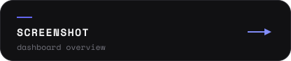</picture></a>
</p>

<p>
<picture>
  <source media="(prefers-color-scheme: light)" srcset="assets/readme/slash-v3-light.svg">
  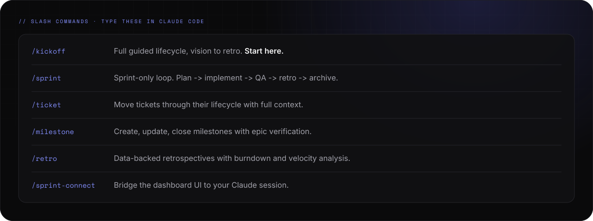
</picture>
</p>

<p>
<picture>
  <source media="(prefers-color-scheme: light)" srcset="assets/readme/skills-v3-light.svg">
  
</picture>
</p>

<p>
<picture>
  <source media="(prefers-color-scheme: light)" srcset="assets/readme/team-v3-light.svg">
  
</picture>
</p>

<p align="center">
<a href="https://github.com/VelimirMueller/claude_development_skills"><picture><source media="(prefers-color-scheme: light)" srcset="assets/readme/links-8-v3-light.svg">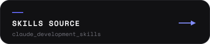</picture></a>
<a href="docs/REFERENCE.md#skill-sets-server-provided"><picture><source media="(prefers-color-scheme: light)" srcset="assets/readme/links-9-v3-light.svg">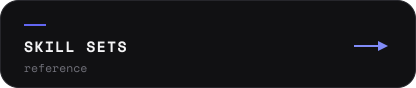</picture></a>
<a href="docs/REFERENCE.md#the-agent-team"><picture><source media="(prefers-color-scheme: light)" srcset="assets/readme/links-10-v3-light.svg"></picture></a>
</p>

<p>
<picture>
  <source media="(prefers-color-scheme: light)" srcset="assets/readme/phases-v3-light.svg">
  
</picture>
</p>

<p>
<picture>
  <source media="(prefers-color-scheme: light)" srcset="assets/readme/sprint-v3-light.svg">
  
</picture>
</p>

<p>
<picture>
  <source media="(prefers-color-scheme: light)" srcset="assets/readme/stack-v3-light.svg">
  
</picture>
</p>

<p>
<picture>
  <source media="(prefers-color-scheme: light)" srcset="assets/readme/env-v3-light.svg">
  
</picture>
</p>

<p>
<picture>
  <source media="(prefers-color-scheme: light)" srcset="assets/readme/manual-v3-light.svg">
  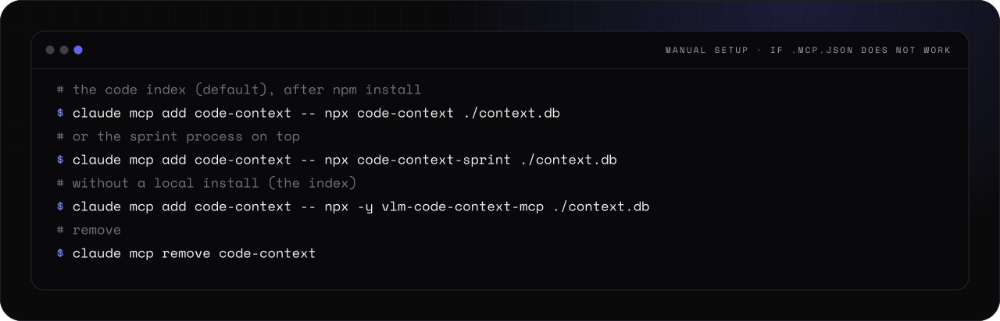
</picture>
</p>

<p>
<picture>
  <source media="(prefers-color-scheme: light)" srcset="assets/readme/dev-v3-light.svg">
  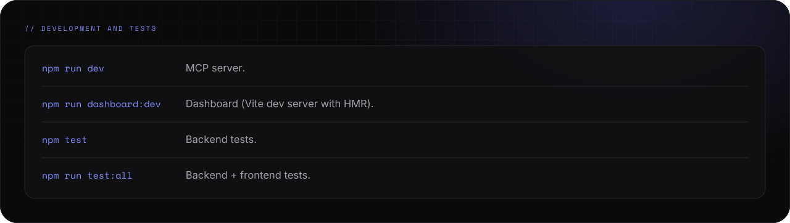
</picture>
</p>

<details>
<summary><picture><source media="(prefers-color-scheme: light)" srcset="assets/readme/links-13-v3-light.svg"></picture></summary>

```bash
# The code index (default), after npm install
claude mcp add code-context -- npx code-context ./context.db

# Or the sprint process instead (same server name, same context.db; includes the code tools)
claude mcp add code-context -- npx code-context-sprint ./context.db

# Without a local install (the index)
claude mcp add code-context -- npx -y vlm-code-context-mcp ./context.db

# Add globally (the index; dist/server/sprint.js for the sprint process)
claude mcp add --scope user code-context node /path/to/node_modules/vlm-code-context-mcp/dist/server/index.js ./context.db

# Remove
claude mcp remove code-context
```

```bash
# Profiles (default: code, 6 tools)
CODE_CONTEXT_PROFILE=full     # 97 tools: the sprint process (setup writes it)
CODE_CONTEXT_PROFILE=all      # 103 tools
CODE_CONTEXT_TOOLSETS=scrum   # add toolsets: code-admin, scrum, fun, stream

# Output
OVERDRIVE_FLAIR=0              # flair off (1 forces it on)
CODE_CONTEXT_TIMESTAMPS=1      # add modified/indexed timestamps
CODE_CONTEXT_ABSOLUTE_PATHS=1  # absolute paths

# Skills
CODE_CONTEXT_SKILLS_AUTOSYNC=1 # sync skills from upstream at boot
```

```bash
# Contributors use pnpm (pnpm-lock.yaml); install once
pnpm install

# MCP server
pnpm run dev

# Dashboard (Vite dev server with HMR)
pnpm run dashboard:dev

# Tests
pnpm test          # backend
pnpm run test:all  # backend + frontend

# Maintainers: publish to the npm registry (runs prepublishOnly = pnpm run build)
pnpm publish
```

</details>

<br>

<p>

</p>

<p>
<picture>
  <source media="(prefers-color-scheme: light)" srcset="assets/readme/status-v3-light.svg">
  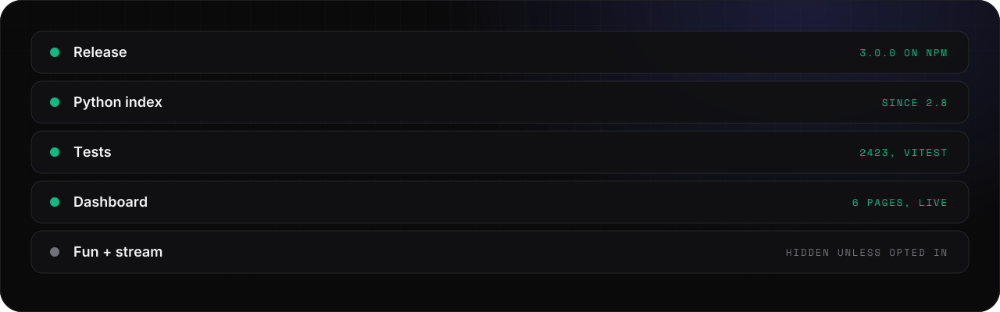
</picture>
</p>

<p>
<picture>
  <source media="(prefers-color-scheme: light)" srcset="assets/readme/release-v3-light.svg">
  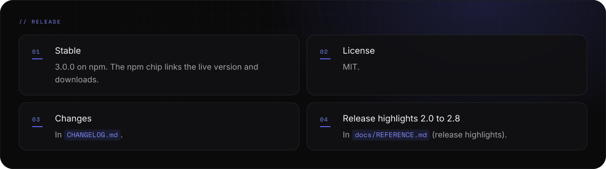
</picture>
</p>

<p align="center">
<a href="CHANGELOG.md"><picture><source media="(prefers-color-scheme: light)" srcset="assets/readme/links-11-v3-light.svg"></picture></a>
<a href="docs/REFERENCE.md#release-highlights"><picture><source media="(prefers-color-scheme: light)" srcset="assets/readme/links-12-v3-light.svg">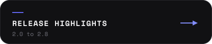</picture></a>
<a href="https://www.npmjs.com/package/vlm-code-context-mcp"><picture><source media="(prefers-color-scheme: light)" srcset="assets/readme/links-1-v3-light.svg"></picture></a>
</p>

<p>
<picture>
  <source media="(prefers-color-scheme: light)" srcset="assets/readme/footer-v3-light.svg">
  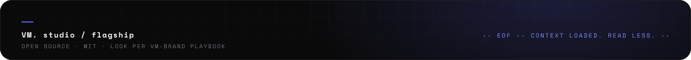
</picture>
</p>
