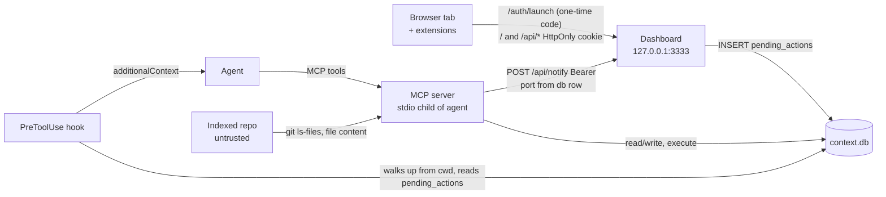

# Threat model: dashboard, bridge and index

Status: written 2026-10-19 against `main` at `4a5e70f` (2.13.0). Issue: #184.

**Result:** the loopback bind, the Host allowlist and the bearer token stop remote and cross-site attackers. The weak point is the token itself: it is in the page, in the SSE URL, in `.env.local` and in a built bundle, and anyone who holds it can give the agent instructions through the bridge. Ten follow-up issues track the gaps (#243–#252); two more fixes are already in flight (#181, #235).

## Scope and assumptions

- code-context is a **local, single-user developer tool**. The MCP server runs as a stdio child of the agent. The dashboard is a Node HTTP server on `127.0.0.1` (default port 3333, falls back up to 3343).
- In scope: the dashboard HTTP API and page, the MCP server → dashboard notify path, the bridge (`/api/bridge/*` and the PreToolUse hook), `context.db` and its backups, the indexer when it reads a repo, and the `query` / `execute` escape hatches.
- Out of scope: a compromised OS account of the user (it can read every file anyway), the agent's own permission model, `sync_github` and the GitHub token handling of `gh`.
- Assumptions:
  - The user runs one dashboard per db. Other OS users on the same machine are **not** trusted.
  - The browser can run hostile pages in other tabs, and the user can have browser extensions installed.
  - Indexed repos are **not** trusted: a cloned or downloaded repo can contain hostile file content.
  - The agent follows instructions that appear in its context (prompt injection works).

## Assets

| Asset                | Where                                                                       | Why it matters                                                                              |
| -------------------- | --------------------------------------------------------------------------- | ------------------------------------------------------------------------------------------- |
| Dashboard token      | `.code-context/dashboard.token` (0600), env `CODE_CONTEXT_DASHBOARD_TOKEN`  | Grants the whole `/api/*` surface, including the bridge.                                    |
| Agent control        | `pending_actions` → PreToolUse hook → agent context                         | The agent has shell and write access with the user's rights.                                |
| Indexed source       | `files.content` in `context.db`, `-wal`, `.bak-*`, `code-context-dump.json` | Full text of every indexed file of every indexed repo, including secrets committed to them. |
| Scrum data and gates | `tickets`, `sprints`, `qa_verified`, `github_*` columns                     | Integrity of the process (DONE, QA, GitHub links).                                          |
| The user's machine   | Processes started by indexing (`git`)                                       | A hostile repo must not run code.                                                           |

## Trust boundaries

1. **Browser ↔ dashboard.** Untrusted pages share the browser. Controls: bind `127.0.0.1`, `Host` allowlist (DNS rebinding), `Origin` check on writes, bearer token or session cookie on the page and `/api/*`, exact dashboard `Origin` on cookie writes (#243).
2. **MCP server ↔ dashboard.** The MCP server sends the token to the port it finds in the db. No check that the listener is the dashboard.
3. **Dashboard ↔ agent (bridge).** A row in `pending_actions` becomes text in the agent context. The hook trusts any row in any `context.db` it finds.
4. **db on disk.** Every process that can read or write `context.db` sits inside this boundary: MCP server, dashboard, hook, reindex CLI, other OS users if the file mode allows.
5. **Indexed repo ↔ indexer.** Repo content and repo-local git config cross into the tool.

## Entry points

| Entry point                                                   | Auth                                                                     | Reaches                                                                                                 |
| ------------------------------------------------------------- | ------------------------------------------------------------------------ | ------------------------------------------------------------------------------------------------------- |
| `GET /`, SPA routes                                           | session cookie or Bearer                                                 | SPA HTML, no token (401 login page without a session, #243)                                             |
| `GET /assets/*`                                               | none                                                                     | Built JS and CSS, no token                                                                              |
| `GET /auth/launch?code=`                                      | one-time code (5 min)                                                    | Starts a random 12 h session; sets the `HttpOnly; SameSite=Strict` cookie `cc_dashboard_session_<port>` |
| `POST /api/auth/logout`                                       | session cookie + exact dashboard `Origin`                                | Ends the session, clears the cookie                                                                     |
| `POST /api/auth/launch`                                       | Bearer only                                                              | Mints a launch code                                                                                     |
| `GET /health`                                                 | none                                                                     | Counts, build hash (`git rev-parse` in cwd)                                                             |
| `GET /api/events` (SSE)                                       | session cookie or Bearer                                                 | Live change events (`?token=` refused, #243)                                                            |
| `GET /api/*` read routes                                      | session cookie or Bearer                                                 | Files incl. content (`/api/file/:id`), full dump (`/api/dump`), scrum data                              |
| `POST/PUT/PATCH/DELETE /api/*`                                | Bearer + loopback `Origin`, or session cookie + exact dashboard `Origin` | Scrum writes, `/api/restore`, `/api/vision`, sprint process                                             |
| `POST /api/bridge/actions`                                    | Bearer + loopback `Origin`, or session cookie + exact dashboard `Origin` | `pending_actions` → agent                                                                               |
| `POST /api/notify`, `/api/notify/event`, `/api/claude-*`      | Bearer + loopback `Origin`, or session cookie + exact dashboard `Origin` | SSE broadcast to every open tab                                                                         |
| PreToolUse hook (`dist/bridge/hook.js`)                       | none (file system)                                                       | First `context.db` found walking up from cwd                                                            |
| MCP tools (`execute`, `export_to_file`, `index_directory`, …) | the agent session                                                        | db writes, file writes, `git` in indexed repos                                                          |

## Rating

- **Likelihood:** Low (needs a rare precondition or a second bug), Medium (realistic for a normal user), High (default setup is exposed).
- **Impact:** Low (hygiene, small leak), Medium (data leak or integrity loss), High (code execution or full agent control).
- **Severity:** High = High impact with Medium or High likelihood. Medium = High impact with Low likelihood, or Medium impact with Medium or High likelihood. Low = everything else. Controlled and accepted rows have no follow-up.

## Findings

| ID    | Surface                               | Threat (STRIDE)                                                                                                                                                                             | L   | I   | Severity            | Current control                                                                                                                                                                                                                         | Gap                                                                                                                                                                                                                                                                                             | Follow-up                  |
| ----- | ------------------------------------- | ------------------------------------------------------------------------------------------------------------------------------------------------------------------------------------------- | --- | --- | ------------------- | --------------------------------------------------------------------------------------------------------------------------------------------------------------------------------------------------------------------------------------- | ----------------------------------------------------------------------------------------------------------------------------------------------------------------------------------------------------------------------------------------------------------------------------------------------- | -------------------------- |
| TM-01 | Token in `/` HTML                     | **I**: any same-origin script, any extension with `localhost` access, and any local process (any OS user) that sends `GET /` reads `window.__DASHBOARD_TOKEN__`.                            | –   | –   | Controlled          | Fixed in #243: no token in any page; the browser logs in through a single-use, 5-minute launch URL that starts a random 12 h session in an `HttpOnly; SameSite=Strict` cookie.                                                          | A launch URL in a terminal or log is valid until used or expired. The cookie reaches every other localhost service the browser visits; it carries one random session id (never the token) that dies after 12 h, on logout or on a dashboard restart, and cookie writes need the exact `Origin`. | #243 (fixed)               |
| TM-02 | SSE `?token=`                         | **I**: the token sits in the request URL — visible in DevTools, HAR exports, proxy logs.                                                                                                    | –   | –   | Controlled          | Fixed in #243: `?token=` is refused; SSE uses the session cookie or the `Authorization` header.                                                                                                                                         | None.                                                                                                                                                                                                                                                                                           | #243 (fixed)               |
| TM-03 | Bridge `custom` action                | **E/T**: a token holder queues `custom` with free JSON; the hook tells the agent to "execute" it. Leaked token = commands run as the user.                                                  | M   | H   | High                | Action allowlist; hook strips control chars from `action` / `entity_type` only.                                                                                                                                                         | `custom` forwarded; `payload` has no schema or cap; hook marks rows completed before the agent acts; no user confirmation.                                                                                                                                                                      | #244                       |
| TM-04 | Hook db discovery                     | **S/T**: `findDb()` takes the first `context.db` walking up 10 levels from cwd; a planted db in a subfolder injects actions with no token.                                                  | L   | H   | Medium              | None.                                                                                                                                                                                                                                   | No configured path, no owner check.                                                                                                                                                                                                                                                             | #245                       |
| TM-05 | MCP → dashboard notify                | **I/S**: the bearer token goes to `localhost:<port>` where `<port>` is the `_dashboard_port` row; `execute`, import or restore can change it; with the dashboard down any listener gets it. | L   | H   | Medium              | Dashboard binds loopback.                                                                                                                                                                                                               | Port trusted from a writable row; `localhost` may resolve to `::1`; no listener check.                                                                                                                                                                                                          | #246                       |
| TM-06 | `execute` tool                        | **T/E**: free `UPDATE` on gate columns (`status`, `qa_verified`, `github_*`), `pending_actions`, `skills._dashboard_port`.                                                                  | M   | M   | Medium              | `sql-guard.ts`: one INSERT/UPDATE/DELETE, no comments, driver `reader` check.                                                                                                                                                           | No table/column restriction.                                                                                                                                                                                                                                                                    | #181 (in flight)           |
| TM-07 | `.env.local` and build                | **I**: every start writes the token to `app/.env.local` (0644); `vite build` from source inlines `VITE_DASHBOARD_TOKEN` into `dist`; npm 2.13.0 ships a test token that way.                | M   | M   | Medium              | `.env*.local` is gitignored.                                                                                                                                                                                                            | Not npm-ignored; prod bundle reads the Vite env var.                                                                                                                                                                                                                                            | #247                       |
| TM-08 | `context.db` on disk                  | **I**: db, `-wal`, `.bak-*` and dumps hold full source of every indexed repo, created 0644 under the default umask.                                                                         | M   | M   | Medium              | `context.db*` added to `.gitignore` by setup; token file is 0600.                                                                                                                                                                       | Data files readable by other OS users.                                                                                                                                                                                                                                                          | #248                       |
| TM-09 | Index policy                          | **I**: `*.pem`, `id_rsa`, `credentials.json`, `*.tfstate` etc. are indexed in full and served to the agent and `/api/file/:id`.                                                             | M   | M   | Medium              | Dotfiles (`.env`), binaries, lockfiles, 512 KB cap skipped.                                                                                                                                                                             | No secret-shaped name rule.                                                                                                                                                                                                                                                                     | #249                       |
| TM-10 | `export_to_file` / `import_from_file` | **T/I**: writes a full dump to any path, reads any path; default dump in cwd is not gitignored.                                                                                             | L   | M   | Low                 | None.                                                                                                                                                                                                                                   | No allowed-root check, no overwrite guard.                                                                                                                                                                                                                                                      | #250                       |
| TM-11 | Hostile repo: git config              | **E**: a repo from an archive carries `core.fsmonitor=<cmd>` in `.git/config`; `git ls-files` during indexing runs it.                                                                      | L   | H   | Medium              | `spawnSync` with arg array, no shell; SHA and `--` guards.                                                                                                                                                                              | Repo-local git config honoured.                                                                                                                                                                                                                                                                 | #251                       |
| TM-12 | Fallback page XSS                     | **T/E**: legacy `dashboard.html` renders vision and milestone markdown into `innerHTML` unescaped; script reads the token. No CSP on any response.                                          | L   | H   | Medium              | React app escapes by default; fallback served only when the build is missing.                                                                                                                                                           | `simpleMarkdown()` does not escape; no `Content-Security-Policy`.                                                                                                                                                                                                                               | #252                       |
| TM-13 | Token file location                   | **I/S**: token resolved from the cwd, so MCP server and dashboard started in different dirs use different tokens, and a token file lands in every cwd.                                      | M   | L   | Low                 | File mode 0600, dir gitignored (`*`).                                                                                                                                                                                                   | Not beside the db.                                                                                                                                                                                                                                                                              | #235 / PR #237 (in flight) |
| TM-14 | DNS rebinding                         | **S**: a hostile hostname re-resolves to 127.0.0.1 and reads `/`.                                                                                                                           | –   | –   | Controlled          | `isAllowedHost`: Host must be `localhost`, `127.0.0.1` or `[::1]` on the bound port.                                                                                                                                                    | None.                                                                                                                                                                                                                                                                                           | –                          |
| TM-15 | Cross-site writes (CSRF)              | **T**: a hostile page POSTs to `/api/*`.                                                                                                                                                    | –   | –   | Controlled          | Bearer token or session cookie required; `isAllowedOrigin` refuses non-loopback and `null` origins; a cookie write needs the exact dashboard `Origin` and no `Sec-Fetch-Site: same-site`/`cross-site` (`isAllowedCookieRequest`, #243). | Any loopback port is an allowed origin for bearer writes (Vite on :5173); still needs the token.                                                                                                                                                                                                | –                          |
| TM-16 | Public `/health`, no rate limit       | **I/D**: any local process reads counts and build hash; floods `/api/*` or SSE.                                                                                                             | L   | L   | Accepted            | 256-bit token makes guessing infeasible; body cap (`MAX_BODY_BYTES`, 413).                                                                                                                                                              | Local DoS only; accepted for a single-user tool.                                                                                                                                                                                                                                                | –                          |
| TM-17 | Prompt injection via indexed content  | **E**: hostile text in an indexed file tells the agent to call `execute`, queue bridge actions or write files.                                                                              | M   | H   | Accepted (residual) | Agent permission prompts; the fixes above shrink what an injected agent can reach.                                                                                                                                                      | Cannot be closed in this tool; #181, #244, #246, #250 remove the worst sinks.                                                                                                                                                                                                                   | –                          |
| TM-18 | Indexer path escape                   | **I**: index `~/.ssh` or follow a symlink out of the repo.                                                                                                                                  | –   | –   | Controlled          | `CODE_CONTEXT_ALLOWED_ROOTS` (cwd by default), lexical + realpath containment, `lstat` (symlinks never followed).                                                                                                                       | None.                                                                                                                                                                                                                                                                                           | –                          |
| TM-19 | `query` tool                          | **T**: a CTE-wrapped write or stacked statement through the read tool.                                                                                                                      | –   | –   | Controlled          | Single statement, no comments, `SELECT`/`WITH`/two PRAGMAs only, driver `reader` check.                                                                                                                                                 | None.                                                                                                                                                                                                                                                                                           | –                          |

## What the controls do today

- **Bind address:** `server.listen(port, '127.0.0.1')` — nothing off-host reaches the dashboard.
- **Host and Origin:** `src/dashboard/auth.ts` (`isAllowedHost`, `isAllowedOrigin`) answer 421 / 403 before auth.
- **Token:** `resolveDashboardToken()` — env var first, else a 32-byte random hex token persisted with mode 0600; compared with `tokensMatch()` (constant time for equal lengths).
- **Browser session (#243):** `LaunchCodes` in `src/dashboard/auth.ts` — single-use 32-byte codes, 5-minute expiry, minted only with the bearer header. `GET /auth/launch` starts a session in `Sessions`: a random 32-byte id held in memory only (keyed by its SHA-256, at most 64, 12 h absolute lifetime), sent as `cc_dashboard_session_<port>` (`HttpOnly; SameSite=Strict; Path=/; Max-Age=43200`). `POST /api/auth/logout` ends it; a dashboard restart ends all of them.
- **Why a random, short-lived session:** cookies are not port-scoped, and `SameSite` treats every localhost port as the same site, so any other local web service the browser visits receives the cookie. A replayed cookie therefore grants one session for at most 12 h and never survives a restart, instead of the token's full lifetime; the port in the cookie name keeps two dashboards apart.
- **Headers:** `X-Content-Type-Options: nosniff`, `X-Frame-Options: DENY`, `Access-Control-Allow-Origin: http://localhost:<port>`. No CSP.
- **Logging:** rejected requests log method, status and path with ids replaced by `:id`; the query string and the token are never logged.
- **Allowed roots:** `index_directory` refuses paths outside the cwd plus `CODE_CONTEXT_ALLOWED_ROOTS`; `reindex --allow-root` adds to that list for one run.

## Follow-ups

| Issue | Title                                                                        | Severity | Breaking |
| ----- | ---------------------------------------------------------------------------- | -------- | -------- |
| #243  | Dashboard: Move browser auth from the page token to an HttpOnly cookie       | Medium   | yes      |
| #244  | Bridge: Stop forwarding free-form actions to the agent                       | High     | yes      |
| #245  | Bridge: Read the hook database from config, not from a directory walk        | Medium   | no       |
| #246  | Scrum: Stop sending the dashboard token to a port read from the db           | Medium   | no       |
| #247  | Dashboard: Stop writing the token to .env.local and inlining it in the build | Medium   | no       |
| #248  | Storage: Create the db, backups and dumps with mode 0600                     | Medium   | no       |
| #249  | Indexer: Skip secret-shaped files                                            | Medium   | no       |
| #250  | Scrum: Keep export_to_file and import_from_file inside the allowed roots     | Low      | no       |
| #251  | Git: Disable repo-local fsmonitor and hooks on every git call                | Medium   | no       |
| #252  | Dashboard: Escape markdown in the fallback page and send a CSP               | Medium   | no       |
| #181  | CCA-37: Stop execute from bypassing the gates (in flight)                    | Medium   | open     |
| #235  | Dashboard: Resolve the auth token from the db directory (PR #237)            | Low      | no       |

Review this model when a new `/api/*` route, a new bridge action, a new file the tool writes, or a new external process call lands.
